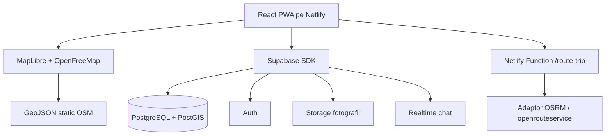
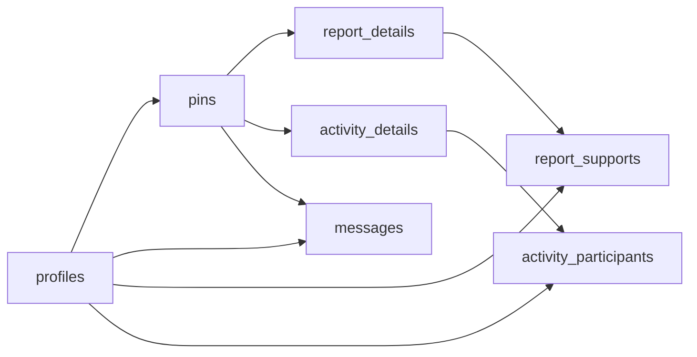
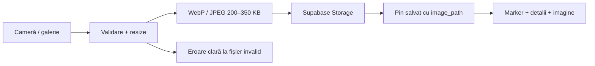
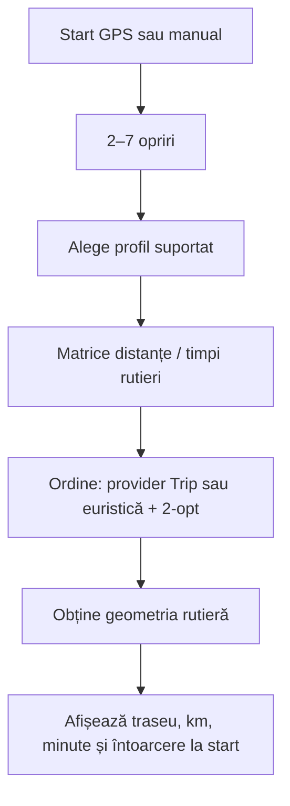

# UNI HACK 48H — COMMUNITY MAP
## Specificație de produs, arhitectură și plan de implementare pentru Codex

**Versiune:** 1.0 (8 noiembrie 2026)  
**Statut:** document de implementare; MVP de hackathon  
**Platformă de publicare:** Netlify (înlocuiește Vercel)  
**Constrângere:** cost suplimentar țintă 0 EUR/lună în limitele planurilor gratuite; Netlify este deja achitat  
**Oraș demonstrativ:** configurabil; alegeți unul singur pentru setul GeoJSON (de exemplu Timișoara), fără a bloca aplicația la acel oraș.

> **Instrucțiune principală pentru Codex:** Livrează o aplicație web responsive, real funcțională, nu un simplu mockup. Implementează incremental, verifică funcționalitatea după fiecare etapă, evită servicii plătite și nu presupune existența unor chei de API. Dacă trebuie să alegi între o funcție exotică și un flux de bază complet și stabil, prioritizează fluxul complet.

## 1. Rezumat executiv și decizii obligatorii

Aplicația este o hartă comunitară („Orașul Meu / Community Map”), în care utilizatorii pot publica probleme ale infrastructurii cu fotografii și GPS, crea activități (ex.: fotbal/voluntariat), iniția discuții într-o locație și genera circuite care vizitează mai multe puncte, cu întoarcere la start.

**Decizia arhitecturală recomandată:** React + Vite + TypeScript + Tailwind + shadcn/ui; MapLibre și OpenFreeMap; Supabase Free (PostgreSQL/PostGIS + Auth + Storage + Realtime); Netlify pentru hostingul frontendului și, doar unde este necesar, funcții serverless; un adaptor de rutare pentru OSRM / openrouteservice; date OSM de infrastructură pregătite ca GeoJSON static.

**Nu construi:** microservicii, aplicații native separate, navigație vocală, algoritmi AI costisitori, căutare globală complexă, integrare fictivă cu primăria, mecanisme de plăți sau chat privat complet independent de hartă.

**Reguli de produs**

1. Sesizările, activitățile și discuțiile sunt **tipuri independente de pin**; o activitate sau o discuție nu necesită o sesizare.
2. Fiecare pin are autor, coordonate, conținut și poate avea conversația sa publică.
3. Harta rămâne interfața principală; fluxurile importante funcționează pe telefon.
4. Modul de sesizare include fotografie, descriere, categorie, locație și confirmări comunitare.
5. Modul de activitate include dată/oră, capacitate, înscriere, distribuire și chat.
6. Rutarea trebuie făcută pe drumuri reale, nu pe linii drepte prezentate ca navigabile.
7. Toate datele publicate trebuie să persiste după refresh și să fie accesibile altor utilizatori autorizați.
8. Încărcarea imaginilor și interogările trebuie optimizate pentru cotele gratuite.
9. Codex lucrează pe etape, cu criterii de acceptare și teste, nu generează aplicația „dintr-o bucată”.

## 2. Priorități: ce intră în cele 48 de ore

| Prioritate | Funcție | Condiție de finalizare |
|---|---|---|
| P0 | Hartă interactivă, filtre și locație | Hartă deschisă pe mobil, markere din DB, GPS cu permisiune |
| P0 | Autentificare simplă | Utilizatorul poate publica și rămâne conectat |
| P0 | Sesizare cu fotografie | Upload comprimat + DB + marker + imagine vizibilă după refresh |
| P0 | Activitate independentă | Creare + înscriere/retragere + locuri afișate corect |
| P0 | Discuție și mesaje persistente | Fiecare pin are mesaje; utilizatori diferiți văd conversația |
| P1 | Realtime chat | Doi utilizatori văd mesajele noi fără refresh |
| P1 | Traseu GPS cu circuit | 2–7 destinații, ordine rezonabilă, traseu real, revenire la start |
| P1 | Straturi OSM | Minimum piste biciclete și linii tramvai pentru orașul demo |
| P1 | Confirmări sesizări | Un singur vot/confirmare per utilizator |
| P2 | Trotuare, clustering avansat, share deep link | Implementați doar dacă P0/P1 sunt stabile |
| P2 | Sesizare → activitate de voluntariat | Legătură între două pinuri, dacă timpul permite |
| P3 | AI foto, mesaje private, notificări push | Exclus din MVP |

Dacă rutarea amenință stabilitatea aplicației, păstreaz-o ca feature izolabil; nu compromite funcțiile P0.

## 3. Fluxurile utilizatorilor

### 3.1 Sesizare: „groapă în asfalt”

1. Deschide harta, apasă „+” → „Sesizare”.
2. GPS-ul sugerează coordonatele; utilizatorul le poate corecta pe hartă.
3. Face poză cu camera telefonului (`accept=image/*`, `capture=environment` ca sugestie) sau selectează o imagine.
4. Introduce titlul, descrierea și categoria.
5. Aplicația validează și comprimă imaginea (țintă 200–350 KB; recomandare maxim ~500 KB, cu limită explicită configurabilă).
6. Încarcă fotografia în Storage și înregistrează pinul și detaliile în DB; la eroare nu lasă pin rupt de fotografie.
7. Markerul devine vizibil; alte persoane pot vizualiza, confirma, comenta și vedea starea.
8. Statusuri recomandate: `open`, `community_confirmed`, `resolved`. Nu afirma că sesizarea e „preluată de autorități”.

### 3.2 Activitate: „fotbal la teren”

1. „+” → „Activitate” → alege terenul pe hartă.
2. Introduce denumire, categorie, dată/oră locală, descriere și capacitate opțională.
3. Publică evenimentul; acesta apare cu marker diferit.
4. Alt utilizator apasă „Participă”, iar numărul locurilor se actualizează în mod atomic.
5. Participanții pot discuta în chatul activității și distribui linkul direct.
6. Organizatorul poate anula activitatea; una expirată nu trebuie prezentată ca „viitoare”.

### 3.3 Discuție fără sesizare

„+” → „Discuție”, selectează locația, pune întrebare, publică. Exemplu: „Avem nevoie de pistă pe această stradă?”. Nu impune fotografie, categorie de sesizare sau dată de eveniment.

### 3.4 Circuit GPS

1. Start = poziția curentă (cu permisiune) sau punct ales manual.
2. Selectează 2–7 destinații de pe hartă sau introduse prin click.
3. Alege un profil suportat (auto / pietonal / bicicletă); dacă providerul nu oferă profilul, arată dezactivat, nu pretinde suport.
4. Un serviciu de rutare calculează drumul rutier/pietonal și ordinea aproximativ optimă.
5. Afișează numerotare, linia GeoJSON, distanța, durata și revenirea la start.
6. Utilizatorul poate șterge puncte și recalcula. Nu se cere navigație turn-by-turn.

## 4. Arhitectură logică



**Fronte:** componente, formulare, geolocație, marker clustering, strat GeoJSON, TanStack Query pentru fetching și stări de cache. **Backend:** Supabase gestionează login, persistență, storage, RLS și chat. **Serverless:** Netlify Function gestionează cheile secrete de rutare și validarea cererilor către furnizori; nu există server permanent de întreținut.

**Contract de coordonate:** GeoJSON, MapLibre și multe API-uri folosesc `[longitude, latitude]` (lon, lat). În UI pot exista câmpurile `latitude`, `longitude`, dar conversia se face printr-un utilitar unic. Verifică punctele cu teste pentru a evita inversarea.

## 5. Ecrane, navigare și UX

| Rută | Element | Comportament |
|---|---|---|
| `/` | Hartă | fullscreen, căutare opțională, chips filtre, GPS, meniu de creare |
| `/pins/:id` | Detalii pin | modal/bottom sheet pe mobil; panou lateral desktop; share link |
| `/create` | Alegere tip | Sesizare / Activitate / Discuție; alegere locație |
| `/routes` | Planificator | colectare opriri, profil, generare circuit și rezumat |
| `/login` | Autentificare | e-mail cu cod/link sau metodă simplă compatibilă cu Supabase |
| `/profile` | Profil | nickname, sesizările și activitățile proprii, logout |

**Wireframe mobil, sus-jos:** header cu branding și filtre → hartă ca suprafață dominantă → controale flotante GPS / layers / buton „+” → bottom sheet cu detalii la atingerea markerului → bară de navigare discretă. Nu crea pagini de dashboard aglomerate. Implementați loading, empty, success, error, accesibilitate de bază și touch targets de minimum ~44 px.

**Coduri vizuale:** sesizări portocaliu, activități verde, discuții violet, localizare albastru, traseu turcoaz; nu comunica tipul exclusiv prin culoare (folosește pictograme și text).

## 6. Structura surselor

```text
community-map/
├── public/
│   ├── data/                   # GeoJSON OSM exportat static
│   │   ├── cycleways.geojson
│   │   ├── tramways.geojson
│   │   └── sidewalks.geojson   # opțional și posibil incomplet
│   └── _redirects             # SPA fallback dacă nu e în netlify.toml
├── src/
│   ├── app/                   # App, providers, router
│   ├── components/ui/         # componente generice
│   ├── components/layout/     # shell responsive, bottom sheets
│   ├── features/
│   │   ├── map/               # MapView, Markers, InfrastructureLayers
│   │   ├── pins/              # modele comune, pin details, CRUD
│   │   ├── reports/           # formulare/status/vot
│   │   ├── activities/        # formular/participare
│   │   ├── discussions/       # creare discuții locale
│   │   ├── chat/              # mesaje și realtime
│   │   ├── routing/           # waypoints + geometrie + adapter
│   │   ├── auth/              # AuthGuard, hooks
│   │   └── profile/
│   ├── lib/                   # supabase client, geo utils, validation
│   ├── types/                 # DB și domeniu
│   └── styles/
├── netlify/functions/
│   └── route-trip.ts          # numai dacă necesită API secret/proxy
├── supabase/
│   ├── migrations/            # schema + RLS + funcții SQL
│   └── seed.sql               # date DEMO separate de producție
├── tests/
│   ├── unit/
│   └── e2e/
├── docs/
│   ├── ARCHITECTURE.md
│   ├── TASKS.md
│   ├── COST_BUDGET.md
│   └── DEMO_RUNBOOK.md
├── netlify.toml
├── .env.example
├── package.json
└── README.md
```

Folosește `React Router`, `TanStack Query`, `Zod` pentru validare și un state minimal local (de exemplu React state/context). Nu adăuga Redux pentru un MVP care nu îl cere.

## 7. Model de date și integritate



### 7.1 Tabelele, câmpurile și regulile

**`profiles`**: `id uuid PK REFERENCES auth.users(id)`, `display_name text`, `avatar_path text nullable`, `created_at timestamptz`. Fără telefon sau date de identitate în MVP.

**`pins`**: `id uuid PK`, `author_id uuid NOT NULL REFERENCES profiles`, `type text CHECK (type in ('report','activity','discussion'))`, `title text`, `description text`, `location geography(Point,4326)` sau `geometry(Point,4326)` indexat GIST, `image_path text nullable`, `created_at`, `updated_at`, `deleted_at nullable`. Folosește un singur câmp spațial ca sursă de adevăr; lat/lon în răspunsurile API pot fi derivate și validate. Dacă alegi și coloane numerice, sincronizează-le prin migrație/triggers și teste.

**`report_details`**: `pin_id uuid PK REFERENCES pins(id) ON DELETE CASCADE`, `category text`, `status text CHECK ('open','community_confirmed','resolved')`, `resolved_at nullable`.

**`activity_details`**: `pin_id uuid PK`, `category text`, `starts_at timestamptz`, `capacity integer nullable CHECK(capacity > 0)`, `status text CHECK ('active','cancelled')`.

**`activity_participants`**: `activity_pin_id uuid`, `user_id uuid`, `joined_at timestamptz`, `PRIMARY KEY(activity_pin_id,user_id)`. Verifică pe server / RPC atomică: înscrierea să nu depășească numărul de locuri când doi utilizatori apasă simultan. Organizatorul poate fi înscris automat prin regulă clară.

**`messages`**: `id uuid`, `pin_id uuid`, `author_id uuid`, `body text` cu 1–2000 de caractere, `created_at timestamptz`; index compus `(pin_id, created_at)`; paginație cu limită.

**`report_supports`**: `report_pin_id uuid`, `user_id uuid`, `created_at`, `PRIMARY KEY(report_pin_id,user_id)`; confirmările sunt distincte de voturile asupra mesajelor.

**Opțional `pin_links`**: legătura `report` → `activity` pentru „transformă problema într-o acțiune”, numai după ce modulele P0 funcționează.

**Integritate obligatorie:** FK-uri, CHECK-uri, timestamp-uri, indecși GIST pe locație, unice pentru confirmări/participanți, consistența `pins.type` cu tabela detaliu (validată în RPC/tranzacție), cascade controlate și soft-delete sau ștergere cu curățare media.

### 7.2 Interogări eficiente

- `get_pins_in_bbox(min_lon,min_lat,max_lon,max_lat,types,categories,limit)` returnează **doar** câmpurile necesare pentru markere, nu mesajele și fotografiile originale.
- Limitează la exemplu 200 rezultate per viewport; folosește debouncing 250–400 ms și anularea cererilor vechi.
- Detaliile și mesajele se încarcă doar la deschiderea unui pin; paginație `limit=30` pentru chat.
- Indecși spațiali și pe `created_at`/`pin_id`.
- Nu descarca toate pinurile orașului și nu subscribe la toate camerele de chat simultan.

## 8. Politici RLS, autentificare și abuz

1. Activează RLS pe fiecare tabel public și pe bucket-urile Storage; anon poate citi doar conținut public permis.
2. Scrierea se face doar ca utilizator autentificat; `author_id = auth.uid()` pentru pin/mesaj.
3. Editează/șterge doar propriile înregistrări; schimbarea statusului `resolved` doar după regula de produs definită (pentru MVP creatorul sau moderatorul), nu prin client arbitrar.
4. Participarea și confirmarea sunt limitate la un rând per utilizator prin PK; numărul maxim de participanți se verifică într-o operație server-side atomică.
5. Bucket public pentru fotografiile sesizărilor numai dacă politica produsului acceptă fotografii publice; folosește căi unice `user-id/pin-id/random.webp` și acces la scriere doar pentru autor. Alternativ bucket privat + signed URLs, dar mai complex și consum suplimentar.
6. Limitează fișierele la `image/jpeg`, `image/png`, `image/webp`, inspectează MIME și semnătura la nevoie, transformă în WebP/JPEG și elimină EXIF/GPS; dimensiune server-side maxim ~1 MB pentru variantele procesate. Pentru upload clasic, imaginile mici sunt ideale.
7. Nu afișa coordonatele exacte ale utilizatorului în profil și nu colecta istoric GPS. Coordonatele pinurilor sunt publice prin proiectare, deci explică asta înainte de publicare.
8. Escapare implicită React, validări Zod, limite de lungime, mesaje de eroare explicite, rate limit simplu pentru creare/upload dacă este fezabil.
9. Secretul `SUPABASE_SERVICE_ROLE_KEY` și cheile de rutare nu ajung în bundle-ul Vite și nici în logurile clientului. `VITE_SUPABASE_ANON_KEY` este o cheie publică; securitatea vine din RLS.
10. Pentru demo, un mecanism minimal de raportare a abuzului/ascundere conținut este preferabil; nu crea sisteme de moderație complexe.

## 9. Fotografii: flux, volum și operațiuni



**Pipeline implementare:** citire File → validare tip/dimensiune → încarcă în canvas/browser processing unde este sigur → resize latură maxim 1280–1600 px → export WebP calitate aproximativ 0.65–0.8 → eliminare EXIF prin re-encodare → upload direct în Storage cu sesiunea utilizatorului → insert DB. Dacă insertul eșuează, șterge uploadul orfan sau implementează un cleanup pe termen scurt. Nu păstra fișierul original decât dacă este necesar.

**Estimări illustrative (nu costuri garantate):** 1 GB = ~4.000 poze x 250 KB, ignorând overhead și alte fișiere; 1000 poze x 250 KB ≈ 250 MB. Vizualizările de imagini consumă trafic de ieșire: 10.000 deschideri a câte 250 KB ≈ 2,5 GB, înainte de caching și overhead. Folosește thumbnail-uri/resize la upload pentru listă dacă traficul devine problemă.

## 10. Date OpenStreetMap și straturi tematice

**Harta de bază:** MapLibre GL JS + stil OpenFreeMap; afișează permanent atribuirea OpenStreetMap/OpenFreeMap. OpenFreeMap declară acces gratuit fără cheie și fără limită formală de vizualizări pentru instanța publică, dar este un serviciu extern best-effort, nu o garanție contractuală.

**Straturi tematice separate de markere:** piste biciclete `highway=cycleway`, `cycleway=*`, eventual `bicycle=designated`; tramvai `railway=tram`; trotuare `sidewalk=*` și `highway=footway` + `footway=sidewalk`. Unele taguri au semantică diferită: traseele trebuie normalizate corect înainte de export. Lipsa unei piste în OSM **nu demonstrează** lipsa ei din oraș.

**Strategie de date pentru 48h:** obține o singură extragere OSM prin Overpass/QGIS/alte unelte; validează și simplifică geometria; exportă GeoJSON static în `public/data`. Nu interoga Overpass pentru fiecare deplasare a hărții. Dacă fișierele sunt mari, împarte-le/folosește tile-uri, dar doar după demonstrarea unei probleme de performanță.

**Căutare după nume de loc:** opțional. Pentru MVP, alegerea manuală pe hartă este suficientă. Nu implementa autocomplete nelimitat direct pe Nominatim public (politica oficială îl interzice).

## 11. Motor de rutare: circuit eficient, nu simpla sortare după distanță



**Observație matematică:** ordonarea opririlor doar după distanța lor față de punctul de start produce adesea un traseu prost. Problema reală este o variantă de *Traveling Salesperson Problem* cu start/stop fixat. Folosește costurile din rețeaua stradală, nu numai distanțe geodezice.

**MVP auto:** adaptor OSRM Trip cu `roundtrip=true`, `source=first`, `geometries=geojson`, `overview=full`, prima coordonată = start. Citește ordinea reală din metadatele de waypoints, nu o ghici. API-ul OSRM poate furniza o aproximație, nu garantează optim absolut. Evită dependența rigidă de un server demo public.

**MVP pietonal/bicicletă:** un adaptor openrouteservice cu profil potrivit; cheie păstrată doar în Netlify Function. Dacă optimizarea este indisponibilă, folosește costuri din matrice + nearest-neighbor + 2-opt și cere la final traseul pe rețeaua respectivă; nu folosi rută auto pentru pietoni. Nu promite un mod de transport până nu l-ai verificat end-to-end.

**Contract recomandat pentru routing:** `RouteRequest { start:{lon,lat}, stops:[{id,lon,lat}], mode:'driving'|'walking'|'cycling', roundTrip:true }`. `RouteResult { orderedStopIds:string[], geometry:GeoJSON.LineString, distanceMeters:number, durationSeconds:number, provider:string, warnings:string[] }`.

**Fallback corect:** provider indisponibil → păstrează punctele selectate și arată „Traseul nu a putut fi calculat. Reîncearcă.” Nu prezenta segmente drept navigație rutieră când sunt linii drepte; dacă există doar un circuit schematic, marchează-l explicit „schematic”.

## 12. Hosting și stocare: recomandarea și alternativele

| Variantă | Ce rulează unde | Avantaje | Dezavantaje / verdict |
|---|---|---|---|
| **A. Recomandată (demo online real)** | UI pe Netlify; Auth/DB/Storage/Realtime în Supabase Free; hărți OpenFreeMap | Simplu, accesibil public, doi utilizatori văd aceleași date, fără laptop pornit | Cote Supabase + proiect Free se poate pune în pauză; **alege aceasta** |
| **B. Dezvoltare integral locală** | UI Vite/Netlify Dev + Supabase CLI/Docker pe laptop, poze în storage local de dezvoltare | Teste fără consum din cloud, migrații reproductibile | Nu e o soluție publică permanentă; **folosește la dezvoltare** |
| **C. Netlify UI + backend pe laptop** | Site public Netlify; server separat de laptop pentru fișiere/DB, expus prin tunel sigur | Datele fizic pe laptop | Laptop pornit, conexiune instabilă, HTTPS/auth/CORS, securitate și backup; **nu pentru prezentarea finală** |
| **D. Demo per-browser fără backend** | Netlify static + IndexedDB/browser local pentru poze și pinuri | Fără Supabase și fără server | Fiecare browser vede doar datele proprii; fără chat real între utilizatori; **doar fallback vizual/offline** |

**Important:** hostingul static Netlify nu poate scrie, de la distanță, în sistemul de fișiere al laptopului. Nu trata `localStorage`/`IndexedDB` ca pe o bază de date comună. Nici filesystem-ul temporar al unei funcții serverless nu înlocuiește un storage persistent. Netlify Blobs este un serviciu separat de stocare, dar are consum/facturare asociată planului; nu îl presupune gratuit doar fiindcă Netlify este deja plătit. Nu activa Netlify Database fără verificarea creditelor și a modelului de facturare al contului.

**Recomandare pentru utilizator:** dezvoltă cu Supabase local, publică Netlify + Supabase Free pentru demo. Păstrează o arhitectură cu repository/adapters astfel încât stocarea imaginilor să poată fi schimbată mai târziu fără a rescrie interfața.

## 13. Buget gratuit: limite verificate și măsuri concrete

*Limite Supabase Free consultate la 8 noiembrie 2026; verifică pagina oficială înainte de lansare.*

| Resursă | Free | Optimizarea proiectului |
|---|---:|---|
| PostgreSQL | 500 MB/proiect | fără imagini în DB; indexuri și selecturi restrânse |
| File Storage | 1 GB | WebP 200–350 KB, ștergere fișiere orfane |
| Egress | 5 GB necached + 5 GB cached | thumbnail, paginare, caching și lazy loading |
| Utilizatori activi lunar | 50.000 | autentificare doar pentru acțiuni de scriere |
| Realtime | 2 milioane mesaje/lună | subscribe numai la camera deschisă |
| Realtime peak | 200 conexiuni | dezabonare la navigare, un singur canal per chat |
| Edge Function invocations | 500.000/lună | minimizare calls; rutare pe Netlify Function când trebuie secret |

**Praguri interne recomandate:** alertă manuală în dashboard la 60–70% din storage/bandwidth, fără procesare automată plătită; limită UI la max 1–3 imagini/sesizare (în MVP mai bine exact una); thumbnail opțional; 30 mesaje/pagină; maximum 200 markere/interogare; un oraș demonstrativ pentru GeoJSON; eliminarea datelor demo inutile. Nu promite „nelimitat”.

**Calcul aproximativ pentru demo:** 300 sesizări × 250 KB ≈ 75 MB fotografii; 1.000 fotografii × 250 KB ≈ 250 MB; 10.000 vizualizări × 250 KB ≈ 2,5 GB transfer înainte de caching. Cost nou proiectat: **0 EUR**, dacă toate limitele și condițiile planurilor aplicabile sunt respectate. Nu include abonamentul Netlify deja deținut.

**Risc:** proiectele Free Supabase cu activitate insuficientă pot fi puse în pauză după circa 7 zile; menține datele de demo exportabile și verifică starea proiectului înainte de jurizare. Fără backup-uri automate complete garantate pe Free; exportă SQL/seed și documentează restaurarea.

## 14. Netlify: configurare și variabile de mediu

Configurație inițială `netlify.toml`:

```toml
[build]
  command = "npm run build"
  publish = "dist"

[[redirects]]
  from = "/*"
  to = "/index.html"
  status = 200
```

Valori publice, accesibile frontendului Vite:

```env
VITE_SUPABASE_URL=https://<project-ref>.supabase.co
VITE_SUPABASE_ANON_KEY=<publishable-or-anon-key>
VITE_MAP_STYLE_URL=https://tiles.openfreemap.org/styles/liberty
VITE_DEFAULT_MAP_LON=<longitude>
VITE_DEFAULT_MAP_LAT=<latitude>
```

Valori server-side, în Netlify environment (dacă folosiți provider extern de rutare):

```env
ORS_API_KEY=<server-only-api-key>
ROUTING_PROVIDER=openrouteservice
```

Nu prefixa cheile private cu `VITE_`. Validarea inputurilor și rate limit-ul serverless rămân obligatorii. Dacă rutarea este exclusiv printr-un provider public fără cheie, documentează clar restricțiile de trafic și nu-l considera SLA.

**Comenzi locale orientative:**

```bash
npm install
npm run dev
npm run build
npm run typecheck
npm run test
# Pentru backend local reproducibil (necesită Supabase CLI + Docker compatibil):
npx supabase init
npx supabase start
npx supabase db reset
# Pentru simulare hosting/functions Netlify:
npx netlify dev
```

**Atenție:** `supabase db reset` șterge și reinițializează datele **locale**; nu folosi echivalentul remote pe date reale. Activează domeniul Netlify în redirect URLs din Supabase Auth și testează loginul pe HTTPS, inclusiv deschiderea directă a unei rute `/pins/:id`.

## 15. Plan de lucru etapizat pentru Codex

| Interval estimat | Fază | Livrabil verificabil |
|---|---|---|
| 0–8 h | F0: bootstrap și hartă | repo, design system, Netlify config, MapLibre, geolocație |
| 8–12 h | F1: schemă/Auth/RLS | migrații, profil, login, roluri, CRUD minimal |
| 12–20 h | F2: sesizări + upload | fotografie și pin persistă; alt client vede conținutul |
| 20–26 h | F3: activități/discuții | creare, înscriere/retragere atomică, discuții independente |
| 26–32 h | F4: chat + vot | mesaje persistente, realtime per pin, confirmare unică |
| 32–40 h | F5: circuite + straturi | rută reală 2–7 puncte, 2 straturi GeoJSON |
| 40–48 h | F6: stabilizare/demo | CI checks, telefon, deployment Netlify, script demonstrație |

Fazele se pot paraleliza doar după stabilirea contractelor comune. Codex trebuie să actualizeze `docs/TASKS.md` după fiecare fază cu status, fișiere create, decizii și blocaje. Dacă apar probleme, taie P2/P3 înainte de a sacrifica testele și demo-ul P0.

**Definition of Done pentru fiecare fază:** proiectul compilează; tipurile trec; nu există erori de console nerezolvate; fluxul poate fi demonstrat; RLS este testată pentru operațiile noi; README este actualizat; nu sunt secrete în git.

## 16. Teste de acceptare / scenariu de jurizare

- [ ] Vizitatorul deschide Netlify și vede harta, filtrele, legenda și markerii publici.
- [ ] Cererea de localizare e explicită și refuzul nu blochează folosirea hărții.
- [ ] Un utilizator autentificat creează o sesizare cu o fotografie comprimată și un punct ales pe hartă.
- [ ] Pagina se reîncarcă, iar sesizarea și poza rămân disponibile.
- [ ] Un al doilea utilizator confirmă sesizarea; repetarea confirmării nu mărește numărătoarea.
- [ ] Primul și al doilea utilizator pot trimite mesaje în chatul sesizării, vizibile în timp real.
- [ ] Un utilizator creează separat o activitate de fotbal; altul se înscrie și apoi se retrage.
- [ ] Capacitatea evenimentului nu poate fi depășită prin două înscrieri simultane.
- [ ] Poate fi creat un pin de discuție fără alte dependențe.
- [ ] Filtrele disting sesizările, activitățile și discuțiile; overlay-urile geografice se comută.
- [ ] Utilizatorul selectează 3–5 opriri și vede un circuit cu revenire la start, distanță și durată.
- [ ] Pentru rutare/API indisponibil, se vede mesaj util și aplicația nu cade.
- [ ] Fotografiile și mesajele unui alt utilizator nu pot fi modificate prin cereri neautorizate.
- [ ] Deep links merg direct după refresh, inclusiv pe mobil.
- [ ] Nu sunt publicate secrete în bundle sau în repository.

**Script de demo (3–4 minute):** A vede o groapă → fotografie și publicare → B confirmă și scrie în chat → A lansează o activitate de voluntariat/fotbal → B se înscrie → ambii văd harta și filtrele → traseu între mai multe probleme sau evenimente → circuit afișat. Pregătiți conturile A/B și 5–10 pinuri DEMO în caz de instabilitate a datelor live. Datele demo trebuie să fie etichetate ca demo.

## 17. Riscuri și fallback-uri

| Risc | Prevenție | Fallback demo |
|---|---|---|
| Supabase depășește Free quota | compresie, paginare, dashboard usage | seed redus, dezactivează uploaduri noi |
| Free Supabase intră în pauză | verificare cu câteva zile și în ziua demo-ului | DB local pentru demonstrație controlată (nu expune public) |
| Providerul de rutare cade | adaptor izolat, timeouts, caching, erori | arată opririle, explică indisponibilitatea rutării |
| OSM infrastructură incompletă | export pentru un singur oraș, legendă „date OSM” | numai straturile verificate |
| Concurență la înscriere | RPC tranzacțională server-side | restricționează capacitatea, nu număra în client |
| Foto prea mare | resize + limite MIME + max bytes | mesaj de eroare și alegerea unei poze mai mici |
| Netlify 404 pe rute | redirect SPA | test direct `/pins/:id` |
| GPS refuzat | start manual | click pe hartă |
| 48h insuficiente | înghețarea scope-ului P0/P1 | nu implementa P2/P3 |

## 18. Instrucțiuni imperative pentru Codex (copy/paste)

> Ești inginerul principal al acestui MVP UniHack de 48 de ore. Citește această specificație integral, inclusiv constrângerile financiare și criteriile de acceptare. Implementarea trebuie să fie o aplicație React + Vite + TypeScript, publicabilă pe Netlify, cu MapLibre + OpenFreeMap și backend Supabase Free, sau cu Supabase local pentru dezvoltare. Nu utiliza Vercel. Nu adăuga infrastructură scumpă sau un server dedicat fără necesitate documentată.
>
> Înainte de cod: creează `docs/ARCHITECTURE.md`, `docs/TASKS.md` și un scurt plan cu dependențe, modul în care se împart fazele și riscurile. Folosește modelul de date din secțiunea 7, RLS din secțiunea 8 și etapele din secțiunea 15. Alege detalii tehnice rezonabile când documentul nu le precizează; nu opri dezvoltarea pentru întrebări triviale. Nu inventa tokenuri, chei, date live sau rezultatele testelor.
>
> Implementează incremental, cu livrabile care funcționează la fiecare pas. Lucrează în ordine: hartă → schemă/Auth → sesizare foto → activitate/discuție → chat și confirmări → circuite GPS → overlay-uri → teste/deploy. Poți inversa două faze dacă dependențele justifică schimbarea, dar documenteaz-o.
>
> Fiecare funcție trebuie să aibă integrare reală, loading/error states, verificări de securitate relevante și teste proporționale. Include `.env.example`, migrații SQL, seed DEMO, scripturi de build/test/typecheck și `netlify.toml`. Nu expune chei secrete. O funcție de routing inoperabilă nu trebuie camuflată ca navigație reală.
>
> După fiecare fază: rulează build, typecheck, teste relevante; actualizează TASKS; explică pe scurt modificările și eventualele blocaje. Înainte de final: rulează lista din secțiunea 16, verifică 2 browsere/2 utilizatori, verifică mobilul, URL-uri directe și publicarea pe Netlify. La blocaj cu API-uri externe, lasă integrarea corect configurabilă prin `.env.example`, implementează un fallback clar și livrează restul funcțional.

## 19. Referințe oficiale și verificări pentru mentenanță

Verificate la 8 noiembrie 2026. URL-urile și limitele se pot modifica; Codex trebuie să verifice din nou la implementare/deploy.

1. Supabase Pricing — https://supabase.com/pricing
2. Supabase Billing (Free / realtime / functions) — https://supabase.com/docs/guides/platform/billing-on-supabase
3. Supabase Local Development — https://supabase.com/docs/guides/local-development
4. Supabase Storage Limits — https://supabase.com/docs/guides/storage/uploads/file-limits
5. Supabase Realtime Limits — https://supabase.com/docs/guides/realtime/limits
6. Netlify SPA redirects — https://docs.netlify.com/manage/routing/redirects/rewrites-proxies/
7. Netlify CLI / local dev — https://docs.netlify.com/api-and-cli-guides/cli-guides/local-development/
8. Netlify Blobs — https://docs.netlify.com/build/data-and-storage/netlify-blobs/
9. Netlify Database billing — https://docs.netlify.com/build/data-and-storage/netlify-database/
10. OpenFreeMap — https://openfreemap.org/
11. OSRM Trip API — https://project-osrm.org/docs/v5.24.0/api/
12. OSM tile usage policy — https://operations.osmfoundation.org/policies/tiles/
13. OSM Nominatim policy — https://operations.osmfoundation.org/policies/nominatim/
14. Supabase Free project pausing — https://supabase.com/docs/guides/platform/free-project-pausing
15. Openrouteservice — https://openrouteservice.org/

**Notă finală:** acest document este o specificație de dezvoltare, nu dovada că aplicația, integrarea cloud sau conturile externe există deja. „Cost 0” reprezintă un obiectiv condiționat de limite și de condițiile comerciale din ziua implementării.
